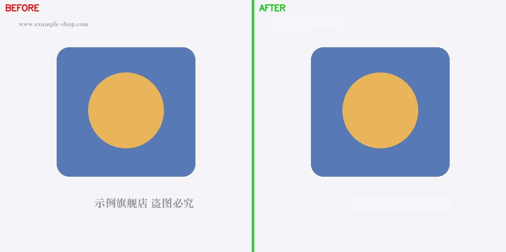
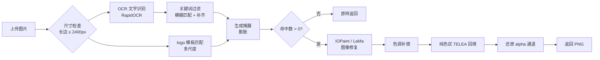

# 🧽 AI Remove Image Watermark

**电商商品图去水印 · 本地部署 · 免费无限次 · 图片不出内网**



> 市面上的去水印 API 要么收费按次、要么限制分辨率、要么要把商品图上传到别人的服务器。
> 这个项目把 **OCR 文字定位 + LaMa 图像修复** 打包成一个 HTTP 服务，在你的机器上跑完，`docker` 都不需要。

---

## ✨ 它能做什么

输入一张带水印的商品图，返回一张去掉水印的图：

| 输入 | 输出 |
| --- | --- |
| 右上角 `sales@xxx.com` | 自动识别并抹除 |
| 底部 `www.xxx.com` / `xx旗舰店 盗图必究` | 自动识别并抹除 |
| 角落品牌 logo 文字 | 自动识别并抹除（也可用模板匹配） |
| 表盘上的品牌名（如 `ACME`）、包装上的 `型号/成分` | **保持原样，不会误删** |

关键点在于：**不是把所有文字都抹掉**。服务先用 OCR 找出所有文字，再用你自己写的关键词（如 `example-shop`、`www.`、`盗图必究`）过滤，只有命中的才进修复队列。所以商品本身的品牌字、参数表、标签都不会被动到。

---

## 🚀 特性

- **关键词驱动**：只删你想删的，命中 0 处时原样返回，绝不乱改图
- **模糊匹配**：OCR 把 `www.example-shop.com` 认成 `mple-shop.com`、把 `Copyright` 认成 `opyright` 也能命中，并按缺失字符比例自动把框补全
- **小图自动增强**：长边 < 900px 时自动上采样 + 锐化后再 OCR，缩略图也能识别
- **多尺度 logo 模板匹配**：传一张 logo 小图，0.4~1.5 倍缩放全图搜索
- **透明通道保留**：PNG 的 alpha 通道原样带回，抠图素材可直接用
- **纯色底二次修复**：白底/灰底商品图先用 LaMa，再用色调补偿 + TELEA 回填，避免出现偏白的矩形块
- **CPU 可跑**：不需要 CUDA / MPS，Intel Mac、普通 Linux 服务器都能用
- **完全本地**：所有推理在本机完成，适合处理不能外传的商品素材

---

## 🔧 工作原理



- 文字检测：[RapidOCR](https://github.com/RapidAI/RapidOCR)（ONNX Runtime，CPU 友好，模型随包下载）
- 图像修复：[IOPaint](https://github.com/Sanster/IOPaint) 的 `big-lama` 模型（约 200MB，首次运行自动下载）
- 服务层：FastAPI + Uvicorn

---

## 📦 环境要求

- Python **3.9+**（3.9 / 3.10 / 3.11 均验证过）
- 无需 GPU，CPU 即可（内存建议 ≥ 4GB）
- macOS / Linux / Windows(WSL) 均可，本机实测环境：Intel i9 + macOS，纯 CPU

---

## ⚡ 快速开始

```bash
git clone https://github.com/aipushmsg/AI-removes-image-watermarks.git
cd AI-removes-image-watermarks

python3 -m venv .venv
source .venv/bin/activate

# iopaint 会自动带上 torch / torchvision 依赖
pip install -r api/requirements.txt iopaint==1.6.0

./start.sh
```

看到下面这行就说明两个服务都起来了：

```json
{"status":"ok","iopaint":200,"model":"lama"}
```

- API 服务：`http://127.0.0.1:8000`
- IOPaint 内部服务：`http://127.0.0.1:8080`（不用直接访问）
- 接口文档（Swagger）：`http://127.0.0.1:8000/docs`

停止服务：

```bash
./stop.sh
```

> **首次启动会下载约 200MB 的 LaMa 模型**，国内网络可先设置镜像：
> `export HF_ENDPOINT=https://hf-mirror.com`（`start.sh` 已默认设置）

> 如果 `torch` 安装失败：macOS x86_64 最高只支持 `torch==2.2.2 + torchvision==0.17.2`；Linux/CUDA 用户按官方命令装对应 CUDA 版本即可。

---

## 📡 API

### `GET /health`

就绪探针，返回 IOPaint 状态与模型名。

```json
{"status": "ok", "iopaint": 200, "model": "lama"}
```

### `POST /v1/mask`

**只生成掩膜，不修复**。强烈建议在批量处理前先用它看一眼检测准不准（白色 = 会被修复的区域）。

| 参数 | 类型 | 默认 | 说明 |
| --- | --- | --- | --- |
| `image` | file | 必填 | 待检测图片 |
| `keywords` | str | `""` | 水印关键词，逗号分隔（中英文逗号都行）；支持 `/正则/` 形式 |
| `template` | file | 无 | logo 小图，用于多尺度模板匹配 |
| `dilate` | int | `5` | 掩膜膨胀半径，越大越安全、越容易伤到周边 |
| `min_score` | float | `0.6` | OCR 置信度阈值 |
| `threshold` | float | `0.8` | 模板匹配阈值 |
| `mode` | str | `keyword` | `keyword` = 仅关键词命中；`all` = 抹掉全部文字（调试用） |

响应：掩膜 PNG，响应头带命中统计

```
X-Hits: 4
X-Coverage: 0.0661
```

### `POST /v1/remove-watermark`

检测 + 修复，返回 PNG。未命中任何水印时**原样返回原图**（`X-Hits: 0`）。

参数同上，另加：

| 参数 | 类型 | 默认 | 说明 |
| --- | --- | --- | --- |
| `hd_strategy` | str | `Original` | IOPaint 的高清策略，`Original` 表示按原图尺寸修复 |

### cURL 示例

先看检测结果：

```bash
curl -X POST http://127.0.0.1:8000/v1/mask \
  -F "image=@product.jpg" \
  -F "keywords=www.example-shop.com,示例旗舰店,盗图必究" \
  -o mask.png -D -
```

确认掩膜没框到商品本身，再去水印：

```bash
curl -X POST http://127.0.0.1:8000/v1/remove-watermark \
  -F "image=@product.jpg" \
  -F "keywords=www.example-shop.com,示例旗舰店,盗图必究" \
  -o product_clean.png -D -
```

带 logo 模板：

```bash
curl -X POST http://127.0.0.1:8000/v1/remove-watermark \
  -F "image=@product.jpg" \
  -F "keywords=example" \
  -F "template=@logo.png" \
  -F "threshold=0.75" \
  -o product_clean.png
```

Python 调用：

```python
import requests

with open("product.jpg", "rb") as f:
    r = requests.post(
        "http://127.0.0.1:8000/v1/remove-watermark",
        files={"image": f},
        data={"keywords": "www.example-shop.com,盗图必究", "dilate": 5},
    )

print(r.headers["X-Hits"])
open("product_clean.png", "wb").write(r.content)
```

---

## 🎯 关键词怎么写

关键词是**唯一**决定"删什么"的开关，建议按这个顺序调：

1. **先跑 `/v1/mask`**，把 `X-Hits` 和掩膜图对一遍，确认没框到商品文字
2. 关键词填水印里**独有的字符串**，越具体越好：
   - ✅ `www.example-shop.com`、`sales@xxx.com`、`盗图必究`
   - ❌ `shop`、`com`（会顺带命中其他文字）
3. 同一站点水印多，就把所有变体都列上：`xxx.com,www.xxx.com,sales@xxx.com,xxx旗舰店`
4. 需要正则时写成 `/pattern/`，例如 `/www\..*\.com/`

> `mode=all` 会抹掉图上**所有**文字，只建议用来排查"为什么这个词没命中"，不要用于正式出图。

---

## ⚠️ 效果与局限（先说清楚）

实测结论，避免你踩坑：

| 场景 | 效果 |
| --- | --- |
| 水印在纯色底 / 黑底 / 纯背景边缘 | ✅ 基本无痕（表链、渐变都能重建） |
| 水印横跨商品主体（表盘、logo、包装正面） | ⚠️ 会糊。LaMa 只能靠周边像素"猜"，精细纹理猜不回来 |
| 大号半透明词标（如压在产品上的巨型半透明站点名） | ❌ 检测不到。低对比度 OCR 读不出，模板匹配得分也只有 0.4 左右 |
| 300×300 缩略图 | ⚠️ 能识别（已自动放大锐化），但分辨率太低，出图意义有限 |
| logo 的图形部分 / 小字 tagline | ⚠️ OCR 只框文字，图形和极小字容易残留 |

**核心结论**：这个工具适合清理**边角文字水印**；如果水印整张覆盖商品，正确做法是拿到无水印源图，而不是指望 AI 硬修。

---

## ⏱ 性能

纯 CPU（Intel i9-9880H）：

| 图片尺寸 | 端到端耗时 |
| --- | --- |
| 800×800 | ≈ 10 秒（OCR 1~2s + LaMa 8~10s） |
| 1200×900 | ≈ 20~30 秒 |

> 长边超过 2400px 会直接返回 `413`，避免 CPU 上跑到天荒地老。批量场景建议先压到 1600px 以内。

---

## 📁 目录结构

```
.
├── api/
│   ├── main.py           # FastAPI 服务：/health /v1/mask /v1/remove-watermark
│   ├── watermark.py      # 掩膜生成：OCR + 关键词模糊匹配 + logo 模板匹配
│   └── requirements.txt  # 服务层依赖
├── docs/demo.jpg         # 效果演示
├── models/               # LaMa 模型缓存（首次运行自动下载，不入库）
├── logs/                 # 运行日志与 pid
├── start.sh              # 一键启动 IOPaint + API
├── stop.sh               # 一键停止
└── LICENSE
```

`models/` 和 `logs/` 已加入 `.gitignore`，不会污染仓库。

---

## ❓FAQ

**Q：为什么不用现成的去水印 API？**
A：收费按次、有分辨率上限，而且要把商品图上传到第三方。这个项目跑在你自己机器上，无限次且不出内网。

**Q：能上 GPU 吗？**
A：能。把 `start.sh` 里的 `--device=cpu` 改成 `--device=cuda` 即可，速度提升明显；本项目默认按 CPU 调优。

**Q：能处理透明 PNG 吗？**
A：能，alpha 通道会原样保留。

**Q：必须上传 3 张图才能用吗？**
A：不需要，单图即可（`/v1/mask` 与 `/v1/remove-watermark` 都是单图接口）。

**Q：服务启动后 `/health` 报 `degraded`？**
A：说明 API 起来了但 IOPaint 还没就绪（首次要下模型），等 1~2 分钟后重试。

---

## 🗺 Roadmap

- [ ] Dockerfile + docker-compose（当前版本需原生安装）
- [ ] 批量处理脚本（遍历目录 + 命中日志）
- [ ] 固定坐标快速模式（同批次图水印位置一致时用 `cv2.inpaint`，比 LaMa 快一个量级）
- [ ] 输出保留原图 EXIF / ICC
- [ ] 简单 Web UI（拖拽上传 + 掩膜预览）

欢迎 Issue / PR。

---

## 📄 License

[MIT](LICENSE)

---

<details>
<summary><b>English</b></summary>

## AI Remove Image Watermark

A self-hosted HTTP service that removes **text watermarks** from e-commerce product photos — locally, for free, with unlimited usage and no data leaving your machine.

**How it works:** RapidOCR detects all text → your keywords filter which text is a watermark → the resulting mask is inpainted by IOPaint's LaMa model → post-processing (tone matching + TELEA fill) removes the "pale rectangle" artifact on flat backgrounds → alpha channel is preserved.

**Why keywords instead of "erase all text":** product photos contain legitimate text (brand names, specs, labels). Keyword filtering guarantees only the watermark lines you name are touched.

**Quick start:**

```bash
git clone https://github.com/aipushmsg/AI-removes-image-watermarks.git
cd AI-removes-image-watermarks
python3 -m venv .venv && source .venv/bin/activate
pip install -r api/requirements.txt iopaint==1.6.0
./start.sh
```

**API:**

```bash
# preview the mask first (white = will be repaired)
curl -X POST http://127.0.0.1:8000/v1/mask \
  -F "image=@product.jpg" -F "keywords=www.example-shop.com" -o mask.png -D -

# then remove
curl -X POST http://127.0.0.1:8000/v1/remove-watermark \
  -F "image=@product.jpg" -F "keywords=www.example-shop.com" -o clean.png -D -
```

**Limitations:** works great on watermarks over flat backgrounds or margins; watermarks covering the product itself will be smudged (inpainting cannot reconstruct fine textures), and large low-contrast translucent wordmarks are not detected by OCR. CPU only is fine (~10s for 800×800).

MIT License.

</details>
